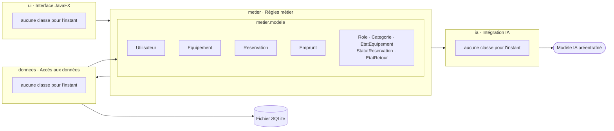

# Architecture : les composants

> **US01** : « Le code sépare quatre parties : interface, règles métier, accès aux données et intégration IA. Les vues ou fenêtres ne contiennent aucune requête de stockage. »

## Schéma des composants

Une flèche veut dire « utilise ». Il n'y a aucune flèche de `ui` vers `donnees` : une fenêtre ne fait jamais de requête, elle passe par un service de `metier`.

## Les quatre parties

Tous les dossiers sont dans `src/main/java/fr/esiee/reservepartage/`.

| Partie | Dossier | Rôle | Peut utiliser | Équipe |
|---|---|---|---|---|
| Interface | `ui` | Fenêtres JavaFX, fichiers FXML, contrôleurs | `metier` | Front |
| Règles métier | `metier` | Services, droits par rôle, validations, statuts, objets du modèle | `donnees`, `ia` | Back |
| Accès aux données | `donnees` | Connexion SQLite, tables, requêtes JDBC paramétrées | objets du modèle | Back |
| Intégration IA | `ia` | Consigne envoyée, appel du modèle, contrôle de la réponse | rien | Back |

Les objets du modèle sont dans `metier/modele` : `Utilisateur`, `Equipement`, `Reservation`, `Emprunt` et leurs énumérations. `donnees` les utilise pour renvoyer ce qu'il lit, sans appeler aucun service.

Le rôle de chaque partie est aussi écrit dans son fichier `package-info.java`.

## Garder le schéma à jour

> **US01** : « Les noms correspondent aux dossiers et classes du projet. » Étape suggérée : « dessiner les composants réellement présents et le sens de leurs dépendances. »

Pour l'instant, seules les classes du modèle existent. À chaque classe ajoutée (service, DAO, fenêtre, composant IA), ajoutez-la au schéma dans sa partie, avec ses flèches, et retirez la mention « aucune classe pour l'instant ».
