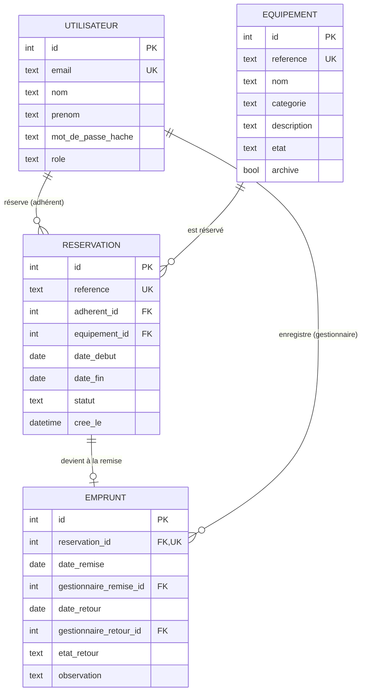
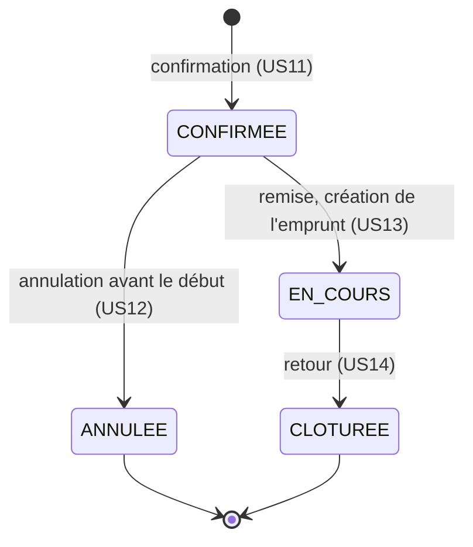

# Modèle de données

> **US01** : « Le modèle de données indique, pour chaque objet, son identifiant, ses champs obligatoires, ses relations, ses statuts et les valeurs qui doivent rester uniques. »

Il reprend les quatre tables du livrable 02 (utilisateur, équipement, réservation, emprunt), corrigées pour suivre le sujet B2-05.

## Schéma

## Utilisateur

| | |
|---|---|
| **Identifiant** | `id` |
| **Champs obligatoires** | `email`, `nom`, `prenom`, `mot_de_passe_hache`, `role` |
| **Relations** | Un adhérent a 0 à n réservations. Un gestionnaire enregistre les remises et les retours. |
| **Statuts** | `role` : `ADHERENT` ou `GESTIONNAIRE` (sujet : « Adhérent / gestionnaire ») |
| **Valeurs uniques** | `email`, qui sert d'identifiant de connexion |

Le mot de passe est stocké haché, jamais en clair (US04).

## Équipement

| | |
|---|---|
| **Identifiant** | `id` |
| **Champs obligatoires** | `reference`, `nom`, `categorie`, `etat`, `archive` |
| **Champ facultatif** | `description` |
| **Relations** | 0 à n réservations |
| **Statuts** | `etat` : `DISPONIBLE` ou `HORS_SERVICE`. `archive` : oui ou non. |
| **Valeurs uniques** | `reference` |

- US08 : « Les états autorisés sont disponible et hors service. »
- US08 : « Un matériel déjà utilisé est archivé plutôt que supprimé. »
- Périmètre du sujet : « un exemplaire par fiche ».
- Pas de champ « disponibilité » : elle se calcule à partir des réservations. US10 : « Seules les réservations confirmées et les prêts en cours bloquent l'objet. »

## Réservation

| | |
|---|---|
| **Identifiant** | `id` |
| **Champs obligatoires** | `reference`, `adherent_id`, `equipement_id`, `date_debut`, `date_fin`, `statut`, `cree_le` |
| **Relations** | 1 adhérent, 1 équipement, 0 ou 1 emprunt |
| **Statuts** | `CONFIRMEE`, `ANNULEE`, `EN_COURS`, `CLOTUREE` (cycle ci-dessous) |
| **Valeurs uniques** | `reference` (US11 : « Référence unique ») |

Contraintes :

- `date_fin` strictement après `date_debut`. La période est [début, fin[ : US10, « un retour le 12 permet un autre départ le 12 ».
- Deux réservations confirmées ou en cours ne se chevauchent jamais sur le même équipement (US11). Ce n'est pas une contrainte SQL : le métier le vérifie au moment de l'enregistrement.

## Emprunt

| | |
|---|---|
| **Identifiant** | `id` |
| **Champs obligatoires** | `reservation_id`, `date_remise`, `gestionnaire_remise_id` |
| **Remplis au retour** | `date_retour`, `gestionnaire_retour_id`, `etat_retour` (`BON` ou `ENDOMMAGE`), `observation` (facultative) |
| **Relations** | 1 réservation, 1 gestionnaire pour la remise, 1 pour le retour |
| **Statuts** | En cours tant que `date_retour` est vide, puis clôturé. Le statut affiché est celui de la réservation. |
| **Valeurs uniques** | `reservation_id` : une seule remise par réservation |

Contraintes :

- US13 : « Une seconde remise de la même réservation est refusée. »
- US14 : la date de retour ne peut pas précéder la remise.
- US14 : « Un matériel signalé endommagé passe hors service. » Le retour et le changement d'état de l'équipement s'enregistrent ensemble.

## Cycle de vie d'une réservation

## Ce qui n'est pas stocké

- **La disponibilité** : calculée à partir des réservations confirmées et en cours (US10).
- **Les retards** : une réservation en cours dont la date de fin est dépassée (US15).

## Corrections par rapport au livrable 02

- Chaque table a maintenant ses propres champs : dans le schéma du L02, les attributs de la réservation étaient reliés à EQUIPEMENT, et ceux de l'équipement à EMPRUNT.
- EMPRUNT reçoit les champs de remise et de retour (US13, US14).
- Ajout de la référence de l'équipement (US08) et de celle de la réservation (US11).
- Suppression de « disponibilité », calculée (US10).
- « mot_de_passe » devient « mot_de_passe_hache » (US04).

## Dans le code

Chaque objet a sa classe dans `src/main/java/fr/esiee/reservepartage/metier/modele/`. Les colonnes en `snake_case` deviennent des champs en `camelCase` (`date_debut` devient `dateDebut`).

| Objet | Classe | Statuts |
|---|---|---|
| Utilisateur | `Utilisateur` | `Role` |
| Équipement | `Equipement` | `Categorie`, `EtatEquipement` |
| Réservation | `Reservation` | `StatutReservation` |
| Emprunt | `Emprunt` | `EtatRetour` |

## Choix appliqués (à valider à deux)

- **Catégories :** liste fixe dans le code (`Categorie` : Bricolage, Jardinage, Événementiel, comme dans les maquettes). Aucune US ne demande de gérer les catégories. Une table à part demanderait des écrans en plus.
- **Statut :** stocké seulement dans la réservation. L'emprunt garde les faits (dates, gestionnaires, état au retour). Un seul endroit à mettre à jour, donc pas de risque que les deux se contredisent.
